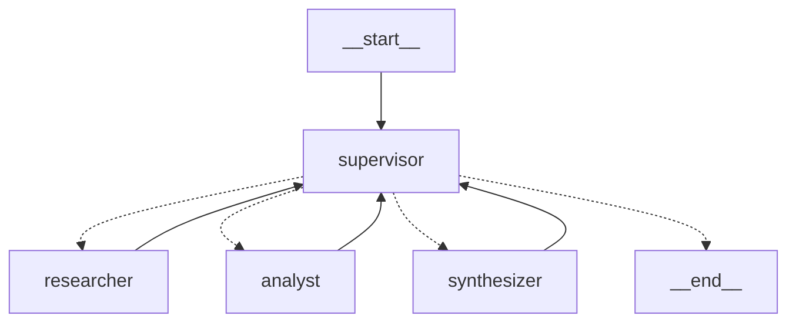

# agentic-research

Asistente de investigación multi-agente. Indexa documentos propios (RAG con ChromaDB) y un equipo de agentes coordinado por un supervisor los investiga, analiza y redacta un informe con las fuentes citadas.

## Cómo funciona



Un **supervisor** (LLM + reglas en código) decide en cada paso quién actúa:

| Agente | Qué hace |
| --- | --- |
| `researcher` | Busca en los documentos indexados con la herramienta `search_documents` (2-3 consultas) y resume los hallazgos citando archivos. |
| `analyst` | Calcula métricas deterministas sobre la evidencia (fragmentos por archivo, porcentajes, etc.) y evalúa su solidez y contradicciones. |
| `synthesizer` | Redacta el informe final con las secciones y el nivel de detalle pedidos. |

Las reglas en código corrigen al LLM cuando propone un paso inválido (por ejemplo, sintetizar sin investigación previa) y el flujo se corta a los 8 pasos (`MAX_STEPS`). Cada decisión queda en `delegation_trace`.

## Requisitos

- Python 3.14 o superior
- [uv](https://docs.astral.sh/uv/)
- Una clave de OpenAI

## Instalación

```powershell
uv sync
```

Crea un archivo `.env` en la raíz con tu clave:

```
OPENAI_API_KEY=sk-...
```

Opcionalmente, añade `REDIS_URL` para guardar los checkpoints de LangGraph (pausas con `interrupt`, reanudar ejecuciones) en Redis. Sirve un Redis local con Docker (`redis://localhost:6379`) o uno gratuito de [Redis Cloud](https://redis.io/try-free). Hace falta que incluya los módulos RedisJSON y RediSearch (`redis-stack-server` y Redis Cloud los traen). Sin `REDIS_URL` se usa memoria. Hay un ejemplo en `.env.example`.

Modelos usados: `gpt-4o-mini` (chat) y `text-embedding-3-small` (embeddings), configurables en `src/agentic_research/app/config.py`.

## Uso

Todo se hace desde la raíz del proyecto con el comando `agentic-research`:

```powershell
# 1. Indexar los documentos de src/agentic_research/data/
uv run agentic-research index

# 2. Investigar un tema con el equipo de agentes
uv run agentic-research research "abandono en el registro de la app"
uv run agentic-research research "abandono en el registro de la app" --detail high

# Preguntar directamente a los documentos (RAG simple)
uv run agentic-research ask "¿qué porcentaje abandona en el paso del SMS?"

# Borrar el índice
uv run agentic-research reset
```

`research` imprime la traza del supervisor (qué agente actuó y por qué) y después el borrador del informe. `--detail` acepta `low` (por defecto, breve) o `high` (con cifras y fuentes).

## Interfaz web

La API (FastAPI) sirve también la interfaz en la raíz. Necesita Redis (`REDIS_URL`). Un solo comando arranca la API y el worker y abre el navegador:

```powershell
uv run agentic-research serve              # --port 8000, --no-browser
```

En Windows también puedes hacer doble clic en `iniciar.bat`.

Por separado (por ejemplo para desarrollo con recarga):

```powershell
uv run python -m agentic_research.app.worker
uv run uvicorn agentic_research.app.api:app --reload
```

Desde la interfaz (<http://localhost:8000>) puedes crear un informe, seguir en vivo qué agente actúa y por qué, leer el borrador con sus fuentes citadas (cada cita abre el fragmento que la respalda), aprobarlo o pedir cambios, y consultar el historial.

| Endpoint | Qué hace |
| --- | --- |
| `POST /jobs` | Crea un informe (`topic`, `sections`, `detail_level`) |
| `GET /jobs` | Lista los jobs, el más reciente primero (`?limit=`) |
| `GET /jobs/{id}` | Estado, `trace` (decisiones del supervisor), `draft` y `sources` |
| `PATCH /jobs/{id}/review` | `approve` o `changes` (con `feedback`) |

## Demo pública

La misma interfaz funciona sin backend con datos simulados (un informe de ejemplo que se genera paso a paso, en inglés y español). Sirve para enseñar el proyecto en un portfolio sin alojar la API, el worker ni Redis, y sin gastar créditos de OpenAI.

```powershell
python scripts/build_demo.py          # genera dist-demo/ con el modo demo activado
npx vercel dist-demo --prod           # o sube la carpeta a cualquier hosting estático
```

Para probarla en local con la API real, abre `http://localhost:8000/?demo`. Añade `?lang=es` o `?lang=en` para fijar el idioma.

## Estructura

```
src/agentic_research/
├── app/
│   ├── main.py             CLI (index, reset, ask, research, review)
│   ├── api.py              API REST + sirve la interfaz
│   ├── worker.py           Ejecuta los jobs y publica su progreso
│   ├── web/                Interfaz (HTML/CSS/JS sin build) y demo.js (backend simulado)
│   ├── graph.py            Grafo de LangGraph, supervisor y reglas
│   ├── agents.py           researcher, analyst y synthesizer
│   ├── supervisor_brain.py Decisión de ruta del supervisor (LLM)
│   ├── state.py            ResearchState compartido entre nodos
│   ├── models.py           Modelos Pydantic (ResearchRequest, Source, RouteDecision)
│   ├── rag.py              Indexación y búsqueda con ChromaDB
│   ├── qa.py               Preguntas y respuestas sobre los documentos
│   ├── llm.py              Cliente del LLM
│   └── config.py           Configuración y variables de entorno
├── data/                   Documentos a investigar (.md)
└── domain/                 Prácticas numeradas (practica1.py ... practica24.py)
```

Las prácticas de `domain/` son ejercicios sueltos. Se ejecutan desde la raíz con:

```powershell
uv run python src/agentic_research/domain/practica23.py
```

`practica23.py` imprime el diagrama Mermaid del grafo (guardado también en `grafo.mmd`).

## Stack

LangGraph, LangChain, ChromaDB, OpenAI y Pydantic.
